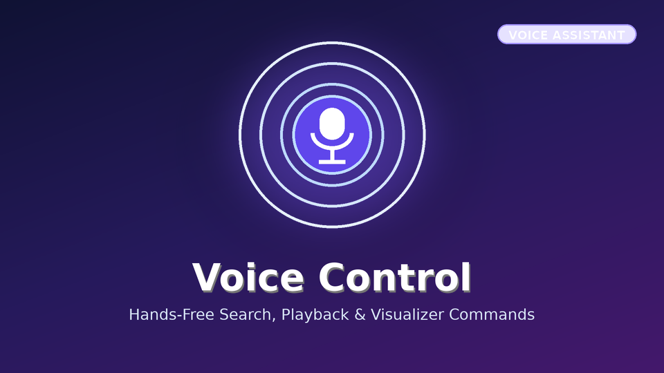

# Voice Control (Jellyfin.Plugin.VoiceControl)



Toolbar voice assistant with local Whisper.net speech recognition fallback (supports Tesla browser, Firefox, Chromium, and Chrome) for Jellyfin 12.4.

## Installation via Jellyfin Plugin Repository

Add the following repository URL in **Dashboard -> Plugins -> Repositories**:

```
https://raw.githubusercontent.com/koopjm/jellyfin-plugins/main/manifest.json
```
